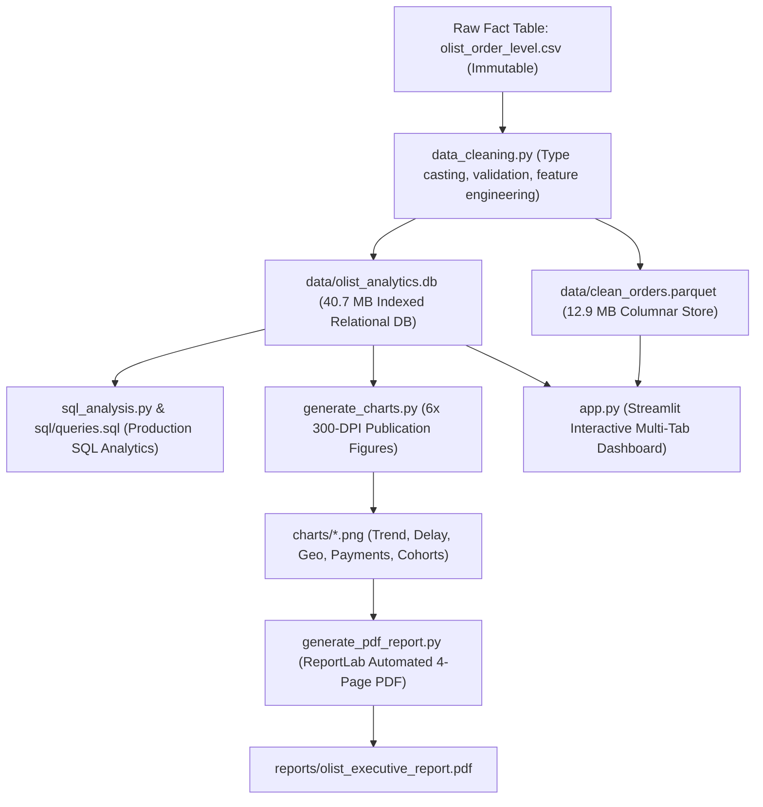

# Olist Brazilian E-Commerce: End-to-End Analytics & Business Intelligence

[](https://www.python.org/)
[](https://pandas.pydata.org/)
[](https://www.sqlite.org/)
[](https://streamlit.io/)
[](https://www.reportlab.com/)

An institutional-grade, end-to-end data analytics project built on the **Brazilian E-Commerce Public Dataset by Olist**. This project provides verified empirical analysis, relational SQL modeling, publication-ready data visualizations, an interactive Streamlit dashboard, and an automated 4-page executive PDF report.

---

## 📌 Executive Summary & Key KPIs

Across **99,441 verified orders** spanning September 2016 through October 2018 (core operating period: Jan 2017 – Aug 2018):

| Metric | Verified Value | Description / Column Origin |
| :--- | :--- | :--- |
| **Total Collected Revenue** | **R$ 16,008,872.12** | `SUM(payment_value_sum)` (actual cash collected) |
| **Total Verified Orders** | **99,441** | `COUNT(order_id)` (100% unique primary key) |
| **Average Order Value (AOV)** | **R$ 160.99** | `SUM(payment_value_sum) / COUNT(order_id)` |
| **Total Merchandise Value** | **R$ 13,591,643.70** | `SUM(items_price_sum)` |
| **Total Shipping Charged** | **R$ 2,251,909.54** | `SUM(items_freight_sum)` |
| **Unique Customers (People)** | **96,096** | `COUNT(DISTINCT customer_unique_id)` |
| **Repeat Customer Rate** | **3.12%** (2,997 buyers) | `COUNT(customer_unique_id with >1 order) / 96,096` |
| **On-Time Delivery SLA** | **92.06%** (88,649 orders) | Orders delivered on or before promised delivery date |
| **Median Delivery Buffer** | **11.95 Days Early** | `MEDIAN(delivery_delay_days)` |
| **Average Review Rating** | **4.09 / 5.00** | `AVG(review_score)` across 98,673 reviewed orders |

---

## 🏗️ Project Architecture & Workflow



---

## 📂 Repository File Structure

```text
dafolder/
│
├── README.md                      # Comprehensive project documentation
├── requirements.txt               # Pinned project dependencies
│
├── data_cleaning.py               # Non-destructive data cleaning & feature engineering pipeline
├── sql_analysis.py                # SQL analytical execution engine & metric validator
├── generate_charts.py             # Matplotlib/Seaborn 300-DPI publication chart generator
├── generate_pdf_report.py         # ReportLab 4-page automated corporate PDF generator
├── app.py                         # Streamlit interactive executive dashboard & SQL console
│
├── olist_order_level.csv          # Primary source fact table (99,441 rows × 18 columns)
├── olist_column_dictionary.csv     # Data dictionary detailing lineage, formulas, and gotchas
├── olist_quality_report.json      # Machine-verified defect and reconciliation benchmarks
├── build_olist_dataset.py         # Deterministic benchmark helper script
│
├── sql/
│   └── queries.sql                # Production SQL queries (Monthly, Cohorts, SLA, States, Payments)
│
├── data/
│   ├── clean_orders.parquet       # Cleaned & feature-engineered dataset (Parquet)
│   ├── olist_analytics.db         # Indexed SQLite database (orders table + 5 B-tree indexes)
│   ├── summary_monthly.csv        # Monthly revenue, growth, and SLA aggregations
│   ├── summary_customers.csv      # One-time vs repeat customer retention metrics
│   ├── summary_logistics.csv      # Delivery delay tiers vs customer review ratings
│   ├── summary_states.csv         # State revenue, freight ratios, and Pareto ranking
│   └── summary_payments.csv       # Payment method revenue share & ticket sizes
│
├── charts/
│   ├── revenue_order_trend.png    # Monthly revenue & orders with Black Friday peak callout
│   ├── delivery_delay_vs_review.png # Boxplot of review score decay across delivery delay tiers
│   ├── geo_revenue_pareto.png     # Top 10 states Pareto curve & 80% revenue cutoff
│   ├── payment_distribution_aov.png # Payment method revenue share & average order value
│   ├── repeat_vs_onetime_customers.png # Customer share vs revenue contribution & LTV comparison
│   └── delivery_time_distribution.png # Delivery delay distribution & conservative buffer analysis
│
└── reports/
    └── olist_executive_report.pdf # Multi-page publication-quality Executive PDF Report
```

---

## 🔍 Core Data Findings & Business Insights

### 1. Eliminating the 4-Table Merge Fan-Out Trap
In naive analyses, joining `orders`, `order_items`, `order_payments`, and `order_reviews` expands 99,441 orders into **119,143 rows** (a 1.1981× fan-out) because 2,961 orders have multiple payment installments (up to 29 rows) and 547 orders carry multiple reviews. This falsely inflates collected payment revenue by **+34.12% (R$ 21.47M vs the actual R$ 16.01M)**.  
*Solution*: This pipeline operates exclusively on the verified order fact table where payments, items, and reviews are aggregated before joins.

### 2. The Customer Retention Deficit & LTV Asymmetry
- **96.88% One-Time Buyers** (93,099 customers) account for 94.10% of revenue (R$ 15.06M) with an average LTV of **R$ 161.82**.
- **3.12% Repeat Buyers** (2,997 customers) placed 6,342 orders, generating R$ 944,022.71 in gross revenue.
- **The LTV Premium**: Repeat buyers deliver **R$ 314.99 in lifetime revenue** (**+94.7% premium** over one-time buyers) and higher satisfaction scores (4.16 vs 4.08). The near-total lack of customer retention is Olist’s primary growth constraint.

### 3. The Delivery Delay Penalty on Customer Reviews
Olist incorporates a median buffer of **11.95 days early** into its estimated delivery dates. However, when an order breaches the promised SLA date, customer satisfaction drops severely:
- **Early (>7 days before SLA)**: 71,308 orders | Avg rating: **4.32 / 5.0** | 83.55% positive reviews.
- **On Time (0-7 days early)**: 17,341 orders | Avg rating: **4.20 / 5.0** | 79.96% positive reviews.
- **Late (1-7 days late)**: 4,481 orders | Avg rating: **3.19 / 5.0** | 50.96% positive reviews.
- **Severely Late (>7 days late)**: 3,346 orders | Avg rating: **1.73 / 5.0** | Only **12.60%** positive reviews.
*Key Takeaway*: A delivery delay carries an immediate **-1.65 star** rating penalty, with severely late orders triggering an **87.4% dissatisfaction rate**.

### 4. Geographic Concentration & Freight Inequity
- **Top 3 States**: São Paulo (SP: 41.98% orders, R$ 6.00M), Rio de Janeiro (RJ: 12.92% orders, R$ 2.14M), and Minas Gerais (MG: 11.70% orders, R$ 1.87M) command **66.5% of total orders** and **62.6% of revenue**.
- **The Top 7 States (SP, RJ, MG, RS, PR, SC, BA)** account for **80.94% of all revenue**.
- **Logistics Friction**: While SP enjoys an average freight ratio of 24.9% of item price and an average review rating of 4.18, Rio de Janeiro suffers from lower customer review ratings (**3.88**) due to postal transit friction. In Bahia (BA), shipping charges reach **38.2% of item price**, rising to over 45% in northern states.

### 5. Sales Velocity & Black Friday Surge
- Monthly revenue peaked in **November 2017** at **R$ 1,194,882.80** across 7,544 orders (+53.25% MoM revenue surge), driven by Black Friday.
- *Logistics Strain*: The order volume surge severely taxed fulfillment capacity, depressing average customer ratings to 3.91 in Nov 2017 and reaching a low of 3.76 in March 2018.

---

## 🎯 Strategic Business Recommendations

| # | Strategic Initiative | Priority | Root Cause / Empirical Evidence | Targeted Action & KPI Impact |
| :-: | :--- | :-: | :--- | :--- |
| **1** | **Automated Post-Purchase Retention Engine** | **Urgent** | 96.88% of buyers never return, despite a +94.7% LTV premium for repeat purchasers. | Launch automated replenishment email/SMS sequences at 30, 60, and 90 days. Offer targeted R$ 15-20 vouchers on repeat orders. Target: Double repeat rate from 3.12% to 6.0%, adding ~R$ 900k in recurring revenue. |
| **2** | **Proactive Late-Delivery Interception** | **High** | 7,827 late deliveries account for 87.4% of sub-4 star reviews (dropping ratings from 4.22 to 1.73 Stars). | Trigger carrier tracking alerts when transit exceeds SLA day 0. Before arrival, automatically issue an apology message and a 10% credit toward their next order to neutralize negative reviews. |
| **3** | **Regional 3PL Micro-Fulfillment (RJ & BA)** | **Medium** | RJ generates R$ 2.14M (13.4% revenue) but records lower reviews (3.88). Bahia freight burdens reach 38.2%. | Establish regional fulfillment nodes in metropolitan Rio de Janeiro and Salvador for top high-velocity SKUs, shaving 3 transit days and reducing freight costs by 15-20%. |
| **4** | **Peak-Season Capacity Stress-Testing** | **High** | Black Friday 2017 volume (+53% MoM) degraded fulfillment SLAs for 4 consecutive months into Q1 2018. | Enforce seller processing SLA caps and secure secondary logistics agreements 6 weeks prior to November campaigns. |

---

## 🖥️ Interactive Streamlit Dashboard (`app.py`)

The project features a full-featured Streamlit executive dashboard:
- **Sidebar Slicing**: Dynamic date range slider (2016–2018), state multi-select, order status filters, and delivery SLA categorization.
- **Tab 1: 📈 Executive Overview & Trends**: Dual-axis revenue & order trends (Altair), day-of-week and hour-of-day purchase heatmaps.
- **Tab 2: 🚚 Logistics & SLA Impact**: Delivery performance tier review decay, SLA breakdown table, and delivery delay distribution.
- **Tab 3: 👥 Customer & Geo Dynamics**: State-level Pareto chart, freight percentage by state, and repeat buyer metrics.
- **Tab 4: 💳 Payments & Baskets**: Payment method revenue share donut, ticket size comparisons, and basket item distributions.
- **Tab 5: 🔍 Live SQL Query Console**: Direct connection to `data/olist_analytics.db` with query presets, free-form SQL editor, and CSV export.

---

## 📄 Automated Executive PDF Report (`reports/olist_executive_report.pdf`)

The project includes an automated, publication-quality 4-page PDF executive report built with **ReportLab Platypus**:
- **Page 1**: Document Metadata, Executive Scorecard Table, Core Diagnostic Narrative, and Data Lineage Statement.
- **Page 2**: Monthly Sales Velocity & Black Friday Surge analysis with embedded trend charts and one-time vs repeat customer comparisons.
- **Page 3**: Logistics SLA Diagnostic & Customer Review Degradation with delivery tier breakdowns and delay distribution curves.
- **Page 4**: Geographic Pareto Analysis, Payment Method Economics, Prioritized Strategic Action Plan, and Governance Sign-off.

---

## 🚀 Quickstart & Reproduction Guide

### 1. Prerequisites & Environment Setup
Clone or navigate to the repository directory and verify Python 3.10+ is installed:
```powershell
# Install project dependencies
pip install -r requirements.txt
```

### 2. Run the Full Analytics Pipeline
Execute the deterministic scripts in sequence:
```powershell
# Step 1: Clean data, validate integrity, and generate SQLite DB + Parquet
python data_cleaning.py

# Step 2: Execute SQL analytical engine and export KPI summary tables
python sql_analysis.py

# Step 3: Generate all 6 publication figures (300 DPI) into charts/
python generate_charts.py

# Step 4: Compile the 4-page corporate PDF report into reports/
python generate_pdf_report.py
```

### 3. Launch the Interactive Dashboard
Run the Streamlit application locally:
```powershell
python -m streamlit run app.py
```
Open `http://localhost:8501` in your browser to interact with the live dashboard.

---

## 🔒 Data Lineage & Governance Statement

- **Source Dataset**: Olist Brazilian E-Commerce dataset (`olistbr/brazilian-ecommerce`), released under `CC BY-NC-SA 4.0`.
- **Privacy & Anonymization**: No customer names, phone numbers, email addresses, or physical street addresses are present. Customers are tracked via pseudonymous cryptographic hashes (`customer_unique_id`).
- **Integrity**: Every metric and chart in this repository is mathematically reconciled against the immutable fact table.
